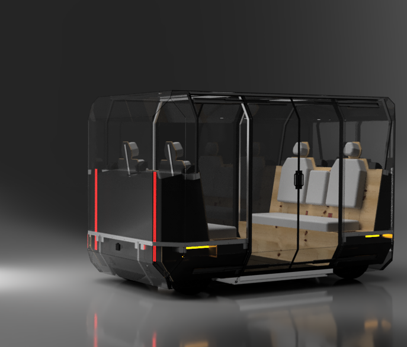
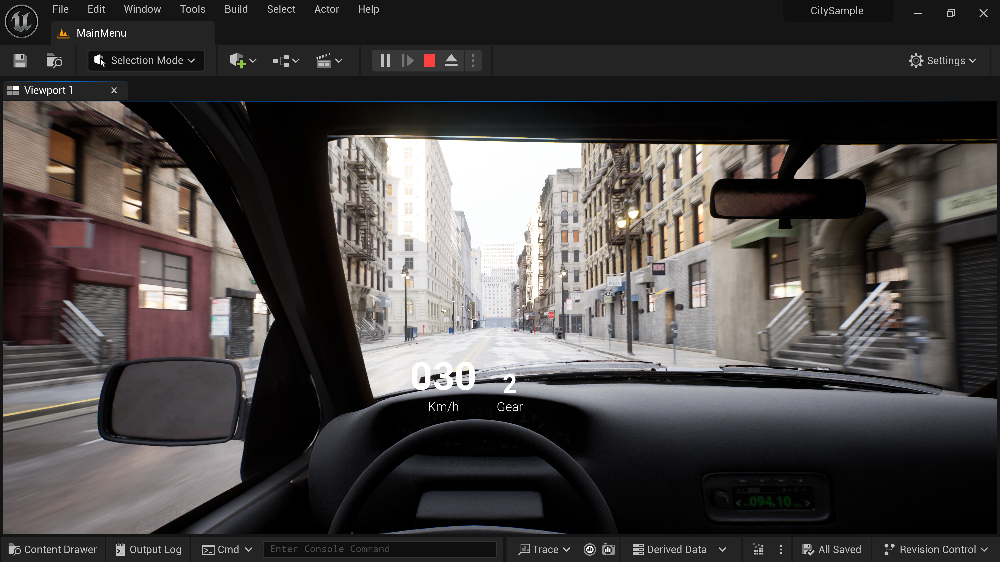
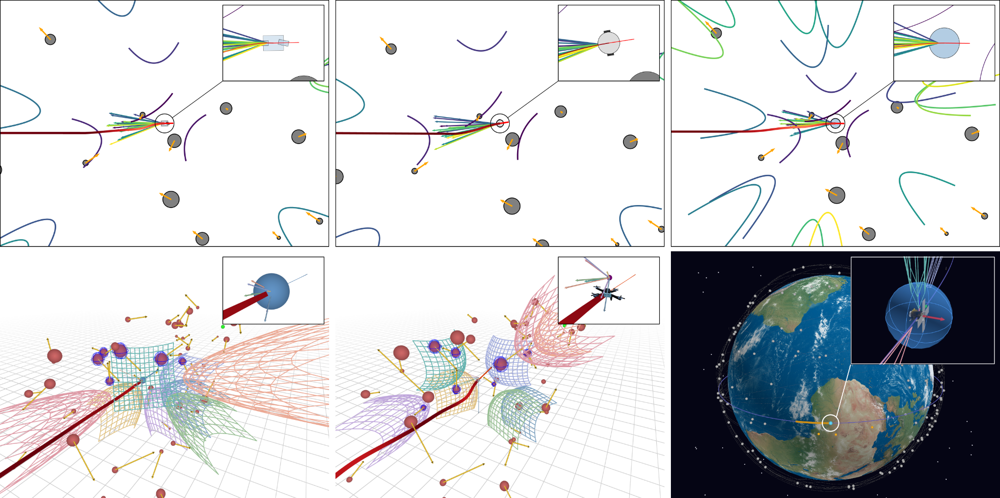
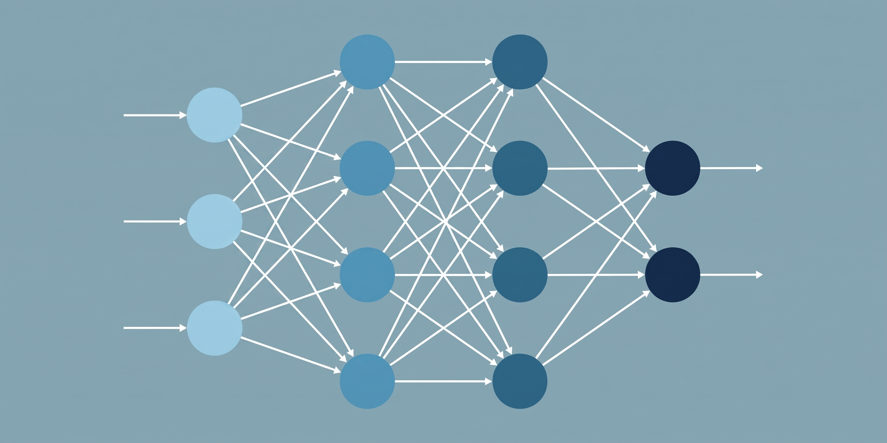

<!-- brief intro -->
I am a **Robotics x CS student** at the **University of Michigan**, dedicated to bridging the gap between high-level code and physical motion. My work sits at the intersection of autonomous systems, deep learning, and robust software architecture. 

Beyond the code, I’m passionate about distilling complex concepts into intuition. Whether through tutoring or my work as an IA, I find as much fulfillment in debugging a peer’s logic as I do in optimizing a robot’s trajectory.

<!-- current project -->
<h2 class="section-header build">What I’m ENGINEERING</h2>

  

    

      
    

    

      <h3>NiFT Autonomous Shuttle</h3>
      Perot Jain TechLab at Mcity
      
Co-leading the team that is turning the NiFT Shuttle QB into an L4 autonomous vehicle. This fall I rebuilt our ROS 2 stack so it drives the same way in simulation and on the road, as groundwork for a VLA driver. You can drive it yourself in the browser.

      

        <a class="repo-link" href="https://kane-weng.github.io/nift_playground/"><i class="fas fa-play-circle"></i> Live Demo</a>
        <a class="repo-link" href="{{ '/projects/nift/' | relative_url }}"><i class="fas fa-arrow-right"></i> Project Page</a>
      

    

  

  
    <!-- Can add/delete reverse  -->
    

      <h3>SIM-26 Driving Simulator</h3>
      Multidisciplinary Design Program
      
Leading development on an accessible driving simulator powered by Unreal Engine 5 to assist research on driver workload and distraction.

      

        <a class="repo-link" href="{{ '/projects/sim-26/' | relative_url }}"><i class="fas fa-arrow-right"></i> Project Page</a>
      

    

    

      
    

  

  

    

      
    

    

      <h3>Safety-Critical Control with CBFs</h3>
      Distributed Autonomous Systems and Control Lab
      
Extending Dynamic Parabolic Control Barrier Functions from 2D to 3D for navigation in dense environments, and deploying Policy Library CBFs on a DJI RoboMaster tracked by Vicon.

      

        <a class="repo-link" href="https://dasc-lab.github.io/"><i class="fas fa-flask"></i> DASC Lab</a>
        <a class="repo-link" href="{{ '/projects/dasc/' | relative_url }}"><i class="fas fa-arrow-right"></i> Project Page</a>
      

    

  

  <!-- Hidden showcase: SURE ended Jul 2026, kept here in case it comes back -->
  <!-- 

    

      <h3>Visual Physics Dataset</h3>
      Corso Group, SURE 2026
      
Packing 7 large-scale 3D datasets into one cluster-ready HDF5 source and benchmarking VLM/LLM mass estimation for physically grounded AI.

    

    

      
    

  
 -->

<!-- current position -->
<h2 class="section-header teach">What I’m MENTORING</h2>

  

    
    

      U-M CSE | Fall 2026 – Now
      <h3>EECS 445 Instructional Aide</h3>
      
Leading weekly discussion sections and office hours for 250+ students in Introduction to Machine Learning, and building and checking projects against reference solutions so the autograder catches edge cases.

    

  

  

    
    

      U-M Robotics | 2026 – Now
      <h3>ROB 320 Instructional Aide</h3>
      
Leading lab sections, holding office hours, and writing exams on Linux IPC, the Robot Interprocess eXchange (RIX) middleware, and kinematics and transforms.

    

  

<!-- current course -->
<h2 class="section-header learn">What I’m mastering</h2>

<!-- Fall 2026 courses. Tags come from the course descriptions below -->

<!-- Feedback control design/analysis for robotics applications, including mobile robots, actuators, and flexible joints. Classical and modern control topics include state space representations, linearization, time response, stability, block diagrams, transfer functions, poles/zeros, root locus, frequency response, Bode plots, gain/phase margins, and lead/lag/PID control.
 -->

  

    ROB 314
    <h4>Introduction to Robot Controls</h4>
    
MATLAB

    
Feedback Control

    
Linear/Nonlinear Systems

    
State Space

    
Root Locus

    
Bode Plots & Margins

    
Lead/Lag & PID

  

  <!-- Development of full-stack autonomous navigation and mapping for mobile robots. Topics include dead reckoning from odometry, sensor modeling of LIDAR and cameras, visual odometry, path planning, and simultaneous localization and mapping (SLAM). Course topics will be implemented in hardware. -->
  

    ROB 330
    <h4>Localization, Mapping, and Navigation</h4>
    
C++

    
Python

    
Odometry

    
LiDAR & Camera Models

    
Visual Odometry

    
Path Planning

    
SLAM

    
Hardware

  

<!-- By the end of the course you can
Choose a 3D representation from the downstream task, collision checking, grasp synthesis, navigation, rendering, and justify the memory, latency, and accuracy tradeoff.
Compose and calibrate a multi-sensor 3D perception stack, and reason about pose and its uncertainty on SE(3).
Build a metric-semantic map and a queryable 3D scene graph from a posed RGB-D sequence using open-vocabulary 2D foundation models.
Explain what a world model predicts, what it is conditioned on, and why visual fidelity is a poor proxy for usefulness in closed-loop control.
Read, present, and critique a current research paper, and reproduce a published result well enough to know where it breaks. -->
  

    ROB 498
    <h4>3D Robot Perception</h4>
    
Python

    
3D Representations

    
Multi-Sensor Calibration

    
Pose on SE(3)

    
Metric-Semantic Maps

    
3D Scene Graphs

    
World Models

  

<!-- skills -->
<h2 class="section-header build">Tech Stacks</h2>

  

    kane@umich:~
    

      &#8211; &#9634; &times; 
    

  

  
  

    
cat /etc/issue

    <code class="output">Ubuntu 22.04.5 LTS</code>
    
ls -m ./languages

    <code class="output">
      C/C++, Python, Julia, MATLAB, R, Verilog, ARM_Assembly, Blueprint
    </code>
    
ros2 pkg list | grep "autonomy"

    <code class="output">
      nav2, tf2_ros, eigen, robot_localization, gazebo_sim, rviz2, fast_dds
    </code>
    
pip list --format=columns

    <code class="output">
      Package &nbsp;&nbsp;&nbsp;&nbsp;&nbsp;&nbsp;&nbsp; Version  
      ------- &nbsp;&nbsp;&nbsp;&nbsp;&nbsp;&nbsp;&nbsp; -------  
      torch &nbsp;&nbsp;&nbsp;&nbsp;&nbsp;&nbsp;&nbsp;&nbsp;&nbsp; 2.2.0  
      opencv-python &nbsp; 4.9.0  
      scikit-learn &nbsp;&nbsp; 1.4.1  
      scipy &nbsp;&nbsp;&nbsp;&nbsp;&nbsp;&nbsp;&nbsp;&nbsp;&nbsp; 1.12.0  
      numpy &nbsp;&nbsp;&nbsp;&nbsp;&nbsp;&nbsp;&nbsp;&nbsp;&nbsp; 1.26.4  
      matplotlib&nbsp;&nbsp;&nbsp;&nbsp;&nbsp;&nbsp;3.10.6  
      pandas &nbsp;&nbsp;&nbsp;&nbsp;&nbsp;&nbsp;&nbsp;&nbsp; 2.2.1
    </code>
    
ls /usr/local/bin

    <code class="output">
      docker&nbsp;&nbsp; git&nbsp;&nbsp; cmake&nbsp;&nbsp; gdb&nbsp;&nbsp; valgrind
    </code>
    
 _

  

<!-- explore more -->
<h2 class="section-header learn">Explore More</h2>

Check out my other past projects, my highlighted courseworks, and my work experiences:

  <a href="/my-site/projects/" class="btn btn--explore">View All Projects</a>
  <a href="/my-site/experiences/" class="btn btn--explore">View All Experiences</a>

